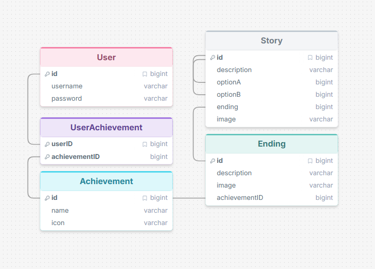
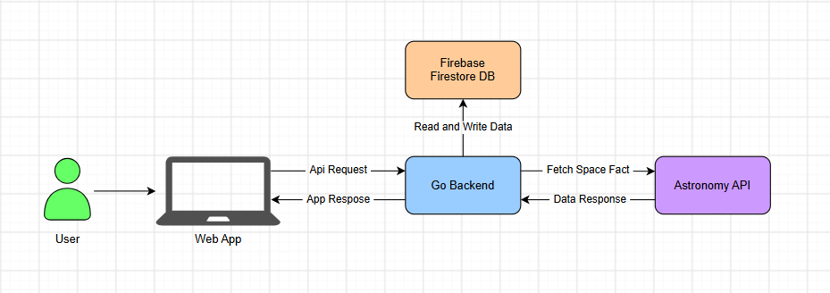
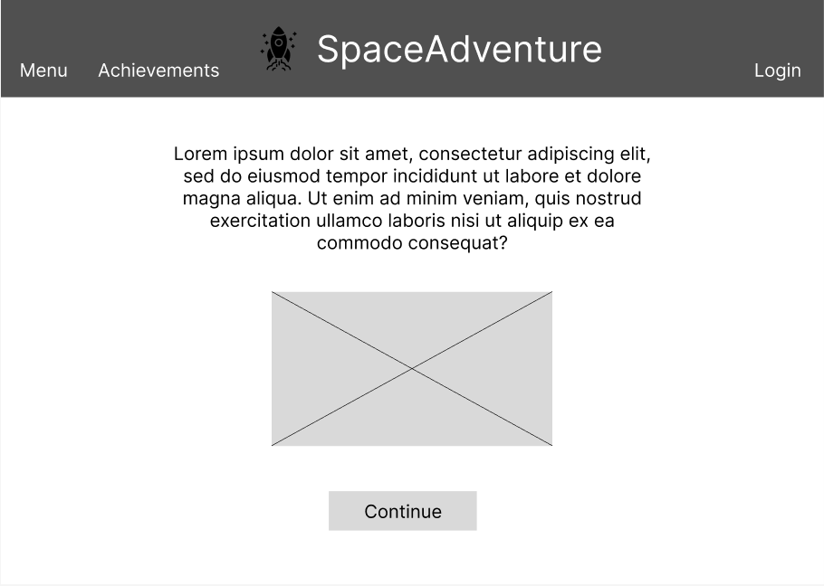
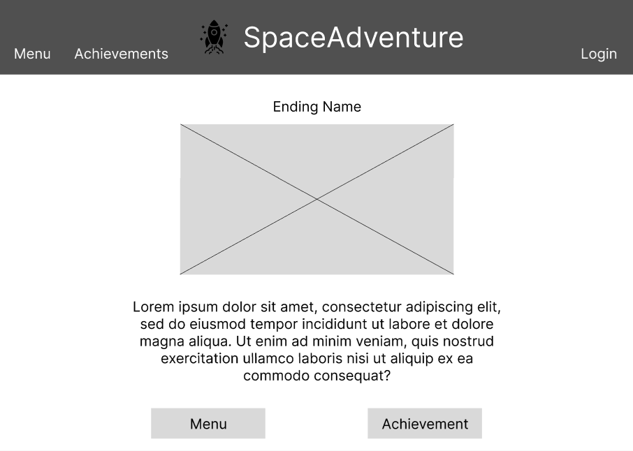
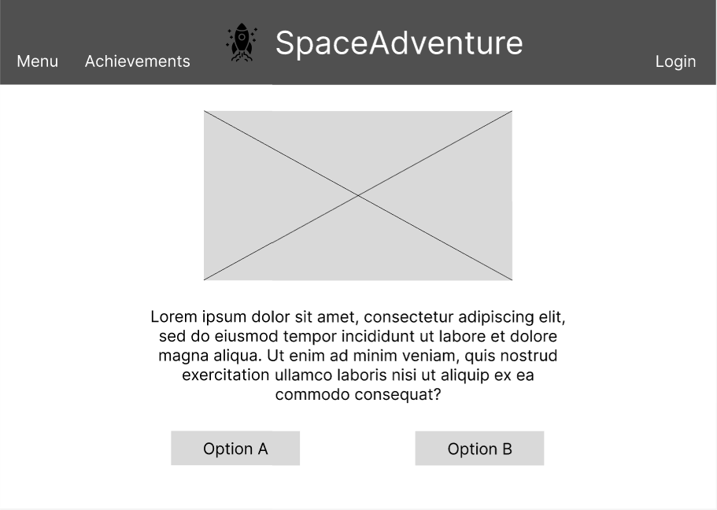
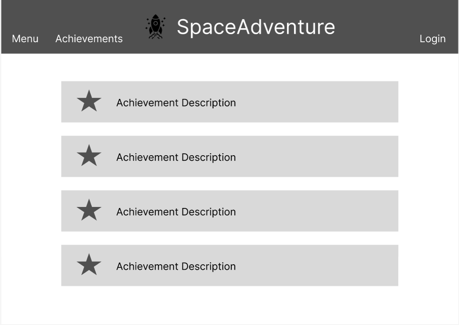

# Space Adventure

With so many mind-numbing apps today that only allow you to meet one boring objective, it's important to keep your mind 
creatively engaged. That's why Space Adventure allows users to explore a virtual world through exploring different 
choices. Each decision leads to another, and when your path reaches an ending you are rewarded with an acheivement. 
Then, you can begin again to choose a different course, gaining a new achievement each time you finish a path.

## Goals
- Secure login
- Ability to select path options
- Background images that are related to the option selected
- New endings discovered are stored in achievements page
- Choice to play again once an ending is reached
- Database storage for users, story points, and achievements

## Technology Stack
- **Go**: Server-side rendering, business logic
- **Template**: Layout formatting and display
- **CSS**: Application styling that is user-friendly and accessible
- **Firebase:** NoSQL storage

## User Interface Design
### Menu

### Story

### Ending

### Achievements

## Log

| Date     | Task                                      | Hours |
|:---------|:------------------------------------------|:-----:|
| 11/17/26 | Setup repo, decide on a project and stack |   1   |
| 11/19/26 | Diagram design and update documentation   |   2   |
|          | Total                                     |   3   |

### Tasks
1. Create base layout (2 hours)
2. Create database with test data (1 hour)
3. Write backend endpoints (5 hours)
4. Create pages (3 hours)
5. Add styling (5 hours)
6. Add stories, choices, and achievements to db (5 - 10 hours)
7. Deploy to prd

Additional Features to implement if I have extra time:
- admin page with ability to change story points in the database
- story map with checkpoints